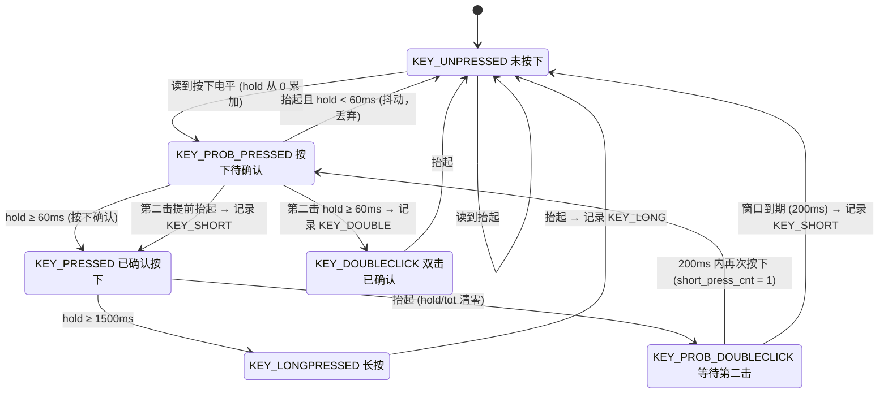

# key_detec —— 物理按键事件处理框架（phy_key）

一个无动态内存分配、与硬件解耦的 MCU 物理按键事件驱动框架。通过周期扫描 + 显式状态机，把 GPIO 电平转换成 **短按 / 长按 / 双击** 三类应用层事件。

---

## 1. 介绍

### 1.1 解决什么问题

裸机项目里的按键代码通常长这样：`if (IO == 0) { delay(20); if (IO == 0) { ... } }`——阻塞、无法同时处理多个键、双击和长按要另写一堆时间判断、按键逻辑和业务逻辑糊在一起。

本模块把这些工作收敛到一个独立模块里：

- 每 10 ms 调用一次 `phy_key_scan()`，只做采样与状态推进，**不阻塞**
- 按键动作以事件形式入队，业务代码在需要的位置调用 `phy_key_handler()` 取事件
- 支持多键并行（最多 `KEY_MAX_NUM` = 10 个）
- 三类事件：`KEY_SHORT`（短按）、`KEY_LONG`（长按）、`KEY_DOUBLE`（双击）
- 内置抖动抑制：按下确认需要连续保持 60 ms，短于该时间的脉冲被直接丢弃
- 硬件无关：只需实现一个"读电平"回调，GPIO / 矩阵键盘 / ADC 阈值 / 扩展 IO 都能接入

### 1.2 文件说明

| 文件 | 说明 |
| --- | --- |
| `phy_key.h` | 对外接口、配置宏、数据结构定义 |
| `phy_key.c` | 注册、位图 ID 分配、状态机、事件队列、事件分发 |
| `example.c` | STM32（GPIOH）接入示例，含注册与回调写法 |
| `state_machine.vsdx` | 状态机设计图（Visio），与 `phy_key.c` 中的 6 个状态一一对应 |

### 1.3 资源占用特征

- 全部内存为静态数组 `g_phy_key[KEY_MAX_NUM]`，位于 `.bss`，**无 `malloc`、无锁、无递归**
- 无浮点、无除法（除 `% EVT_MAX_NUM` 的取模以及 ID 位运算），适合 Cortex-M0 级别内核
- 单次扫描时间与"已注册键数量"成正比，与总键数/时间无关，执行时间可预估

---

## 2. 架构

### 2.1 分层

```
┌──────────────────────────────────────────────┐
│ 应用层    key1_static_handler(key_val_t)     │  ← 业务只关心"发生了什么事件"
│           LED 翻转 / 菜单切换 / 长按复位 ... │
└───────────────────▲──────────────────────────┘
                    │ phy_key_handler(id) 取出事件并回调
┌───────────────────┴──────────────────────────┐
│ 核心层    phy_key.c                          │
│  ┌────────────────┐  ┌─────────────────────┐ │
│  │ 位图 ID 分配器 │  │ 6 态状态机 / 消抖   │ │
│  │ (注册表)       │  │ 短按/长按/双击判定  │ │
│  └────────────────┘  └─────────────────────┘ │
│  ┌────────────────┐  ┌─────────────────────┐ │
│  │ 已注册键单链表 │  │ 每键事件环形队列    │ │
│  │ (扫描遍历对象) │  │ 深度 EVT_MAX_NUM=2  │ │
│  └────────────────┘  └─────────────────────┘ │
└───────────────────▲──────────────────────────┘
                    │ drv->ll_read(drv) → PHY_KEY_UP / PHY_KEY_DOWN
┌───────────────────┴──────────────────────────┐
│ 适配层    key_drv_t { priv, ll_init, ll_read }│  ← 用户实现，唯一与硬件耦合处
└───────────────────▲──────────────────────────┘
                    │
┌───────────────────┴──────────────────────────┐
│ 硬件层    GPIO / 矩阵扫描 / ADC / 扩展 IO     │
└──────────────────────────────────────────────┘
```

### 2.2 数据结构

```c
/* 硬件适配：ll_init 可为空，ll_read 必须返回 PHY_KEY_UP 或 PHY_KEY_DOWN */
typedef struct key_drv_ctx {
    void * priv;
    int  (* ll_init)(struct key_drv_ctx *);
    int  (* ll_read)(struct key_drv_ctx *);
} key_drv_t;

/* 单个按键的运行上下文：一个结构体装下状态机、计时、事件队列 */
typedef struct key_dev_ctx {
    int                 id;
    key_drv_t         * drv;
    key_tick_t          hold;      /* 按下已持续的 tick，用于消抖和长按判定 */
    key_tick_t          tot;       /* 双击等待窗口内的累计时间 */
    key_static_handler  handler;
    struct key_dev_ctx * next;     /* 侵入式单链表，串起所有已注册键 */
    key_event_t         evt;       /* 事件环形队列 */
    char                short_press_cnt : 2;
    char                state : 5;
} key_dev_t;
```

关键点：

- **侵入式链表**：`next` 内嵌在 `key_dev_t` 里，不额外分配节点；扫描只遍历已注册的键，注册数少时开销更小。
- **位图分配 ID**：`g_phy_key_bmp` 中某位为 1 表示该 ID 空闲。注册时用 `generic_ffs()` 找最低空闲位，`id = (word << 5) + bit`。比线性查找空槽快，也为将来实现注销留了接口。
- **`state` 只占 5 bit、`short_press_cnt` 占 2 bit**：单键上下文被压到很小，10 个键的静态数组仍在百字节量级。

### 2.3 对外接口

| 接口 | 作用 |
| --- | --- |
| `int phy_key_register(key_static_handler handler, key_drv_t *drv)` | 注册一个键，成功返回 `0 ~ KEY_MAX_NUM-1` 的 id，失败（空指针/无空位）返回 `-1` |
| `void phy_key_scan(void)` | 周期调用（每 `KEYSACN_TIMEBASE` ms），采样 + 状态推进 + 记录事件 |
| `int phy_key_handler(int id)` | 取该键队首事件并调用其回调，返回回调返回值；无事件返回 0 |
| `int phy_key_unregister(int id)` | 当前为空实现（见 5.3） |

### 2.4 状态机

6 个状态，转移条件全部由"当前电平 + `hold` 计时"决定，集中在 `phy_key_scan()` 的 `switch` 中分发到 6 个 `*_state_handler()`。



### 2.5 时间参数

所有时间阈值都按"扫描次数 × 时间片"换算，常量集中在 `phy_key.h`：

| 宏 | 默认值 | 含义 |
| --- | --- | --- |
| `KEYSACN_TIMEBASE` | 10 ms | 扫描周期，`phy_key_scan()` 必须按此节拍调用 |
| `DEBOUNCE_SLICE` | 2 | 消抖占用片数（20 ms） |
| `SHORT_PRESS_SLICE` | 4 | 按下确认附加片数（40 ms） |
| `LONG_PRESS_SLICE` | 150 | 长按判定片数（1500 ms） |
| `STABLE_TIME` | 60 ms | `(DEBOUNCE_SLICE + SHORT_PRESS_SLICE) × TIMEBASE`，按下确认门限 |
| `LONG_PRESS_TIME` | 1500 ms | `LONG_PRESS_SLICE × TIMEBASE`，长按门限 |
| 双击窗口 | 200 ms | 硬编码在 `pro_doubleclick_state_handler()` 内 |

需要注意：`DEBOUNCE_SLICE` 和 `SHORT_PRESS_SLICE` 是**相加**后作为按下确认门限的，所以"短按"的实际定义是——**按下持续 ≥ 60 ms 且 < 1500 ms 的一次释放**。

---

## 3. 设计思路

1. **回调注入代替硬件耦合**
   框架只认识 `ll_read()` 返回的 0/1，不认识 GPIO 寄存器。换平台只改适配层，`phy_key.c` 一行不动。同一个框架也能接矩阵扫描、ADC 阈值、甚至远程按键报文。

2. **采样与业务解耦（事件队列）**
   `phy_key_scan()` 只负责"推进状态机 + 记录事件"，绝不调用业务回调；业务回调统一在 `phy_key_handler()` 里执行。这样扫描可以放在定时中断或主循环节拍点，回调执行时机由应用决定，避免在采样上下文里跑耗时逻辑。

3. **用时间换代码：不做边沿中断回调**
   纯轮询而非 EXTI 中断，代价是最多 `KEYSACN_TIMEBASE`(10 ms) 的响应延迟，换来的是无需处理中断与主循环的并发、无需临界区、无锁。对按键这种人机交互输入，10 ms 延迟不可感知。

4. **显式状态机而不是标志位堆叠**
   6 个状态各自一个处理函数，每个函数只关心"当前电平 + 我的计时器"。抖动、短按、长按、双击是同一套计时的不同判定结果，不是 4 段互相覆盖的 if-else。结构可直接对照 `state_machine.vsdx` 审查。

5. **静态内存与确定性**
   无 `malloc`、无变长数组、无递归。最坏执行时间是"已注册键数 × 常数"，可静态评估，适合有硬实时约束的场合。

6. **位图 ID 分配**
   `g_phy_key_bmp` 以位表示空闲槽位，`generic_ffs()` 一次找到最低空闲位。相比遍历数组判断 `id` 是否被占用，注册是 O(n/32)，且天然保留"归还位即释放 ID"的能力（注销尚未实现）。

---

## 4. 调用示例

### 4.1 三步接入

```c
#include "phy_key.h"

/* 第 1 步：适配层——只做电平翻译 */
static int key1_ll_read(key_drv_t * drv)
{
    /* 上拉输入，按下为低电平 */
    return (GPIOH->IDR & 0x0008u) ? PHY_KEY_UP : PHY_KEY_DOWN;
}

static key_drv_t key1_drv = {
    .priv    = 0,
    .ll_init = 0,              /* GPIO 已在 board_init() 中配好，可留空 */
    .ll_read = key1_ll_read,
};

/* 第 2 步：业务回调——只处理事件，不碰电平 */
static int key1_handler(key_val_t val)
{
    switch (val) {
    case KEY_SHORT:  led_toggle(LED1); break;   /* 短按：翻转指示灯 */
    case KEY_LONG:   system_reset();   break;   /* 长按：复位 */
    case KEY_DOUBLE: menu_next();      break;   /* 双击：切菜单 */
    default: break;
    }
    return 0;
}

/* 第 3 步：注册 + 主循环 */
int main(void)
{
    int key1;

    board_init();                                  /* GPIO/时钟等 */
    key1 = phy_key_register(key1_handler, &key1_drv);
    if (key1 < 0) {
        return -1;                                  /* 空指针或 ID 用尽 */
    }

    for (;;) {
        if (tick_10ms_elapsed()) {                  /* 严格 10 ms 节拍 */
            phy_key_scan();                         /* 采样 + 状态机 */

            for (int i = 0; i < EVT_MAX_NUM; ++i) { /* 消费该键事件队列 */
                (void)phy_key_handler(key1);
            }
        }
        app_task();
    }
}
```

### 4.2 多键

每个键各自一份 `key_drv_t` 和回调，ID 由 `phy_key_register()` 返回，互不干扰：

```c
int id_up   = phy_key_register(up_handler,   &drv_up);
int id_down = phy_key_register(down_handler, &drv_down);
int id_ok   = phy_key_register(ok_handler,   &drv_ok);

/* 消费侧同样按键逐个取事件 */
phy_key_handler(id_up);
phy_key_handler(id_down);
phy_key_handler(id_ok);
```

### 4.3 在定时中断里扫描（可选）

```c
void TIM3_IRQHandler(void)          /* 10 ms 周期 */
{
    if (TIM3->SR & TIM_SR_UIF) {
        TIM3->SR &= ~TIM_SR_UIF;
        phy_key_scan();             /* 只做采样与状态推进，很轻 */
    }
}

/* 主循环里只消费事件 */
for (;;) {
    phy_key_handler(key1);
    app_task();
}
```

### 4.4 移植清单

1. 确认 `PHY_KEY_UP` / `PHY_KEY_DOWN` 与实际电平极性一致（默认低有效：按下 0、抬起 1）。
2. 按实际节拍修改 `KEYSACN_TIMEBASE`，其余时间宏按"需要多少片"同步调整。
3. 按最大按键数修改 `KEY_MAX_NUM`；事件堆积可能时调整 `EVT_MAX_NUM`。
4. 实现 `ll_read()`，保证返回值严格是 `PHY_KEY_UP` 或 `PHY_KEY_DOWN`（`example.c` 用 `!!` 归一化）。
5. 保证 `phy_key_scan()` 调用间隔稳定，否则所有时间判定会等比偏移。

---

## 5. 测试与稳定性

### 5.1 稳定性保障机制

| 机制 | 说明 |
| --- | --- |
| 抖动抑制 | 按下必须连续保持 60 ms 才被确认；更短的脉冲回到 `KEY_UNPRESSED`，不产生任何事件 |
| 无动态内存 | 无 `malloc/free`，不会因碎片或分配失败而失效；运行期内存占用恒定 |
| 扫描无业务代码 | 状态机内只做算术和赋值，回调在 `phy_key_handler()` 中执行，长耗时业务不会拉长采样周期（需应用侧自行保证） |
| 事件与采样解耦 | 队列深度 `EVT_MAX_NUM`，事件不会在采样路径中丢失（除非队列已满） |
| 注册期校验 | `handler` 或 `drv` 为空时注册直接返回 `-1`；`ll_read` 为空的键在扫描中被跳过 |
| 越界保护 | `phy_key_handler()` 校验 `id` 范围，越界返回 `-1`（存在边界缺陷，见 5.3） |
| 可预估的最坏耗时 | 单次 `phy_key_scan()` = 已注册键数 × O(1) |

### 5.2 验证用例矩阵

当前仓库未包含自动化测试代码。下表按状态机实际转移推导，可直接作为主机端桩测试（用波形数组替代 `ll_read()`）或示波器/逻辑分析仪的验证清单：

| # | 用例 | 输入波形（相对第一次按下） | 期望结果 |
| --- | --- | --- | --- |
| 1 | 抖动抑制 | 按下 30 ms → 释放 | 无事件 |
| 2 | 短按 | 按下 100 ms → 释放，随后 200 ms 内不再按下 | 1 次 `KEY_SHORT` |
| 3 | 短按边界 | 按下 60 ms → 释放 | 1 次 `KEY_SHORT`（`hold` 达 `STABLE_TIME` 即确认） |
| 4 | 长按 | 按下 1600 ms → 释放 | 1 次 `KEY_LONG`（在**释放时**上报） |
| 5 | 按住不放 | 持续按下 5 s 不释放 | 无事件（框架不产生连发） |
| 6 | 双击 | 按下 100 ms → 释放 → 间隔 40 ms → 按下 100 ms → 释放 | 1 次 `KEY_DOUBLE`（第二击确认时上报，不再产生 `KEY_SHORT`） |
| 7 | 超时双击 | 两次点击间隔 300 ms（> 200 ms 窗口） | 2 次 `KEY_SHORT` |
| 8 | 快速二次点击 | 第二击仅保持 30 ms（< 60 ms） | 2 次 `KEY_SHORT`（非双击，见 5.3） |
| 9 | 注册超限 | 连续注册 `KEY_MAX_NUM + 1` 个键 | 第 11 个返回 `-1`，前 10 个正常 |
| 10 | 空指针注册 | `phy_key_register(NULL, &drv)` / `(handler, NULL)` | 返回 `-1`，不占用 ID |
| 11 | 事件堆积 | 产生 3 个事件而主循环始终不调用 `phy_key_handler()` | 队列仅保留前 2 个，第 3 个被丢弃，不越界、不覆盖队首 |
| 12 | 节拍丢失 | 主循环阻塞 500 ms 后恢复 10 ms 采样 | 无崩溃；因计时按扫描次数累加，按键时长被低估，可能漏判长按 |

主机端桩测试的写法：把 `ll_read()` 实现为"按扫描次数返回预置电平"的查表函数，逐次调用 `phy_key_scan()`，断言 `phy_key_handler()` 触发的事件序列与上表一致。这样可以在 PC 上覆盖全部 6 个状态，无需硬件。

### 5.3 已知限制

以下均为当前实现的客观行为，使用前需知悉：

1. **长按只在松手时上报**，且只上报一次。不支持"按住即触发"和"按住连发"，长按用于复位、配网等一次动作没有问题，用于加减速调节需要考虑。
2. **第二击必须保持 ≥ 60 ms 才会被识别为双击**。更快的二次点击会退化成两次 `KEY_SHORT`（用例 8）。这是当前状态机 `PROB_PRESSED` + `short_press_cnt` 分支的直接结果。
3. **双击窗口 200 ms 硬编码**在 `pro_doubleclick_state_handler()` 中（`tot >= 200`），未做成配置宏，修改需要动源码，且与其它时间参数不在一处。
4. **事件队列深度 2**，满时丢弃最新事件，且没有溢出标志位，应用层无法感知丢事件。
5. **`phy_key_unregister()` 为空实现**，ID 位图不会归还，键注册后不可回收；动态增删按键的场景不适用。
6. **预留但未使用**的成员/类型：`key_ops_t`、`DIG`/`ANA`、`dig_alo`。其中 `key_ops_t` 是一张接口函数表，当前实现走静态函数 + 链表，未使用该表。
7. **`KEY_MAX_NUM` 取 32 的整数倍时**，`g_last_mask` 的计算会出现移位数 32 的未定义行为（当前为 10，不触发）。
8. **`phy_key_handler()` 的越界检查在取址之后**：`key_dev_t * dev = &g_phy_key[id];` 先于 `id` 校验，负 `id` 严格来说是未定义行为（不会解引用，但不符合安全写法）。
9. **时间精度依赖调用周期**：`hold` 是按调用次数累加的，不使用独立时间戳。节拍抖动会等比放大为按键时间误差；主循环长时间阻塞会漏计按下时长。

---

## 6. 配置速查

```c
#define KEY_MAX_NUM         10   /* 最大按键数（同时受位图容量限制） */
#define EVT_MAX_NUM         2    /* 每键事件队列深度 */
#define KEYSACN_TIMEBASE    10   /* 扫描周期 ms，必须与调用节拍一致 */
#define DEBOUNCE_SLICE      2    /* 20 ms 消抖 */
#define SHORT_PRESS_SLICE   4    /* 40 ms 附加确认，与消抖合计 60 ms */
#define LONG_PRESS_SLICE    150  /* 1500 ms 长按 */
#define PHY_KEY_DOWN        0    /* 按下时的电平 */
#define PHY_KEY_UP          1    /* 抬起时的电平 */
```

事件值（`key_val_t`）：`KEY_NONE = 0`、`KEY_SHORT = 2`、`KEY_LONG = 3`、`KEY_DOUBLE = 5`。数值不连续，应用侧请用枚举名而不是字面量做判断。
